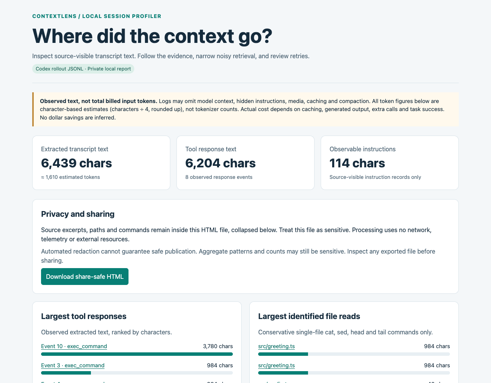

# ContextLens

An offline, deterministic context profiler for **Codex rollout JSONL**. It answers: “Where did my coding agent’s context go, and what can I improve?”

ContextLens reads one explicitly selected session and creates a self-contained HTML report. It measures source-visible transcript text, not complete model context or billed input tokens.



## Quickstart

Requires **Node.js 22.18 or newer**, which runs the TypeScript source directly. No package installation, runtime dependencies, account or API key is required.

```sh
node src/cli.ts /path/to/selected-session.jsonl --out session.private.html
# Open session.private.html in your browser.

# Produce an allowlist-based export with source text omitted:
node src/cli.ts /path/to/selected-session.jsonl --out share-safe.html --share-safe

# Reproduce the demo into a new file:
node src/cli.ts demo/synthetic-codex.jsonl --out my-demo.html

# Meaningful checks:
node --test test/*.test.ts
```

Equivalent npm commands: `npm start -- SESSION.jsonl --out REPORT.html`, `npm test`. Output must be a **new file**; existing paths, symlinks and hard links are refused. This avoids accidentally overwriting either a session or another report. Remove an old demo report yourself before running `npm run demo` again.

Open [demo/report.html](demo/report.html) for the private synthetic example or [demo/share-safe.html](demo/share-safe.html) for its share-safe counterpart. The fixture is hand-authored, small, sanitized, and clearly labeled synthetic. **Neither the screenshot nor demo findings are live-session evidence.**

## What the report shows

- Largest tool responses and conservatively identified file reads, measured in extracted characters.
- Exact duplicate output groups using SHA-256 of complete extracted output text.
- Repeated reads of the same path, command and working directory, distinguishing unchanged from changed **returned content**.
- Repeated identical failed commands and consecutive retry sequences where explicit nonzero exit evidence exists.
- Source-visible system/developer messages and metadata base instructions when present. This is observable instruction text, not a per-request reinjection estimate.
- A filterable timeline, expandable evidence and ranked opportunities linking to their supporting events. Evidence links clear filters automatically.

Ranking uses associated characters as a review priority, not a prediction of waste or savings. Findings overlap; do not add their sizes together.

## Supported format and source research

The MVP supports Codex `session_meta`, `turn_context`, and `response_item` JSONL records: `message`, `function_call`, `function_call_output`, `custom_tool_call`, and `custom_tool_call_output`. Text output can be a string or a typed text-content array. Mirrored `event_msg` entries are ignored to avoid double counting. Unknown record families are ignored; unsupported response item types produce diagnostics. Explicit unknown metadata versions receive a best-effort warning; absent version fields are common. This is a shape-based adapter, not a promise of compatibility with every future Codex release.

We compared [Codex’s public synthetic rollout examples](https://github.com/openai/codex/blob/main/codex-rs/app-server/tests/common/rollout.rs), its [protocol text/output definitions](https://github.com/openai/codex/blob/main/codex-rs/protocol/src/models.rs), and [Claude Code’s structured output documentation](https://code.claude.com/docs/en/headless). The public Codex source was downloaded and inspected locally; no private local session was inspected. Codex was selected because its public record shapes and call IDs support deterministic call/result matching. Claude Code is not yet supported.

[RTK](https://github.com/rtk-ai/rtk) filters and compresses command output at runtime. [Context Mode](https://github.com/mksglu/context-mode) offers sandboxed tool processing, retrieval and session continuity. ContextLens focuses on **after-session, offline evidence reports** from explicitly chosen files. It does not intercept tools or change agent settings. This is a focused distinction, not a claim of originality or measured superiority. Their branding and implementation were not copied.

## Methodology

Parsing, analysis and rendering live separately in `src/parser.ts`, `src/analysis.ts`, and `src/report.ts`. No LLM diagnoses or command execution occur. Recorded text is HTML-escaped; source content is never interpolated into executable JavaScript. Reports have no external dependencies or network requests and include a restrictive content security policy.

Character counts use JavaScript UTF-16 string length. Every token figure is labeled **estimated tokens**, calculated as `ceil(characters / 4)`. This dependency-free heuristic assumes English-like text; it is not a model tokenizer and can be inaccurate for code, other languages and unusual Unicode. No model-specific token accuracy is claimed. Counts cover retained extracted text events, excluding tool arguments, mirrored events, media, hidden context and unknown records. They must not be read as total billed input tokens.

Duplicate hashes use full extracted tool text, including wrappers. For file reads only, a recognized Codex `Chunk ID: … Final output:` wrapper is removed before comparing returned bodies. Wrapper variation outside this recognized shape can cause false “changed returned content” observations. Same outputs do not establish that a whole file was unchanged. Reads with different ranges or command spelling are not compared. No shell commands are run.

Read recognition supports only known shell tools (`exec_command`, `shell`, `shell_command`) with a string `cmd`/`command`: single-file `cat FILE`, `head`/`tail` with compact numeric flags (for example `head -n20 FILE`), and `sed -n '1,20p' FILE`. Glob expansion, shell composition, arrays, custom-tool input text, nested `functions.exec` JavaScript, writes, command substitutions and ambiguous reads are excluded. Relative reads require an observed working directory. Failure detection requires a nonzero `Process exited with code N` status in a recognized anchored Codex execution wrapper, or structured numeric nonzero exit status from a known shell tool. Bare mentions in file content are not counted. Generic error prose is not proof of failure. Retry grouping uses identical command strings and observed working directory; hidden commands, unmatched calls and concurrent execution may limit inference.

## Privacy and limits

Everything runs locally. There is no telemetry, upload, account, paid API, server or automatic session discovery. The input is read-only. Private reports contain sensitive prompts, output excerpts, paths and command arguments even while their evidence panels are collapsed. Keep private reports private.

The share-safe CLI flag and report download build a new report from fixed labels, event IDs and numeric measurements. They omit prompts, source code, tool output, arguments, paths, tool names, timestamps, hashes and source diagnostics. They retain event categories, counts, failure indicators and group relationships. **Automated redaction cannot guarantee safe publication.** Aggregate patterns can remain sensitive; inspect exports before sharing. Collapsing a private excerpt is not redaction.

The parser streams input and bounds each JSON record to 4 MiB, retaining at most 20,000 text events, 20,000 pending calls and 4,000 excerpt characters per event. Retained commands and working directories are capped at 4,000 characters; oversized commands are excluded from command analysis. Full extracted text is hashed before its excerpt is truncated. Malformed, oversized and final partial records are skipped with bounded diagnostics. Record limits preserve progress on large files but make results partial. The report includes those limitations. UTF-8 input is expected. Large reports can still consume significant browser memory.

Logs may omit the complete context sent to a model, encrypted reasoning, media, compaction effects, hidden instructions, cache behavior and token usage. Instruction overhead is unavailable when it is not source-visible. Session timestamps are displayed as source data, with timeline order taken from record order. Caching, output generation, extra calls and task success affect actual cost. ContextLens makes no dollar or percentage savings claims.

## Verification and license

`node --test test/*.test.ts` checks parsing, typed text, mirrored-event exclusion, duplicates, changed/unchanged reads, output wrappers, working-directory separation, failures/retries, malformed/oversized/partial input, null tool arguments, observable instructions, limits, HTML injection, share-safe sentinel omission, and CLI overwrite protection.

Optional browser checks: with a developer-installed `playwright` package and Chromium available, run `node test/browser-check.mjs` from the project root. Set `CONTEXTLENS_PLAYWRIGHT` to an absolute module path and `CONTEXTLENS_BROWSER` to an executable path when using existing installations. This check also refreshes the screenshot. These are development prerequisites, not runtime dependencies.

The screenshot is a real browser render of the synthetic demo report. Browser checks cover filtering, evidence links, share-safe download, keyboard evidence controls and a narrow viewport with evidence expanded. No private or live-session results are claimed. TypeScript uses native Node execution; no separate static type checker is bundled.

**MIT license**, chosen to permit broad reuse, modification and redistribution. See [LICENSE](LICENSE).
